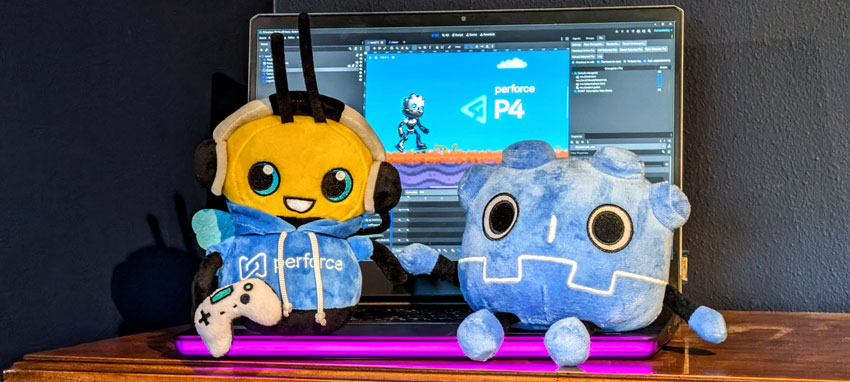

<p align="center">
  
</p>

# P4Godot

P4Godot (P4G for short) connects the Godot 4 editor to Perforce P4 (formerly
Helix Core). Edit a file and Godot offers to check it out. Save, and the
changelist stays accurate. Submit, diff, and reconcile without leaving the
editor. It is pure GDScript with no build step, and it drives the `p4`
command-line client you already use.

**Status: 0.14.1, the first public release.** Developed and tested on
Windows 11 with Godot 4.7 and a P4 2025.2 server. It is designed to work on
macOS and Linux too, but those platforms have had less testing. Please
[open an issue](https://github.com/jase-perf/P4Godot/issues) if something
misbehaves.

<!-- 📷 HERO GIF: the signature loop, captured in one take —
     edit a file in the editor → checkout prompt appears → accept → the file
     shows up under the default changelist in the P4G dock.
     Suggested file: docs/images/hero-checkout.gif -->

## Quick start

You need a Perforce server and an account on it. P4Godot connects to an
existing server and doesn't include one. Get the server address (for example
`ssl:perforce.example.com:1666`), your user name, and your password from
whoever runs it. Setting up your own? Do that first, then come back.

1. **Install the `p4` command-line client.** To check whether you already
   have it, run `p4 -V` in a terminal. If it prints a version, skip this step.
   - Windows: it comes with P4V. You can also get it on its own from
     [perforce.com](https://www.perforce.com/downloads/helix-command-line-client-p4).
   - macOS: `brew install --cask p4`, or download it from the same page.
   - Linux: download it from the same page.
2. **Add the plugin to your project.** From the
   [latest release](https://github.com/jase-perf/P4Godot/releases/latest),
   download `p4godot-v0.14.1.zip` under **Assets**, not the "Source code"
   zips. It contains an `addons` folder. Copy that folder into your project
   folder, next to `project.godot`, merging it with any `addons` folder you
   already have.
3. **Enable it.** Godot saves the list of enabled plugins in
   `project.godot`, which is read-only until you check it out. So first check
   out `project.godot`: in P4V, right-click it → **Check Out**, or run
   `p4 edit project.godot`. Then in Godot, open **Project → Project Settings →
   Plugins** and tick **P4Godot**.
4. **Connect.** The **P4G** dock appears at the bottom of the editor.
   P4Godot needs a *workspace*, Perforce's link between folders on the server
   and a folder on your disk, whose folder contains this project. If the
   `p4` command line already knows it (from `p4 set` or a `P4CONFIG` file),
   P4Godot connects by itself. If you've only used P4V, you'll probably be
   asked to pick the workspace. Setup asks only for what's missing: the
   server address, your password, or the workspace.
5. **Share it with your team.** Press **Reconcile** in the P4G dock to open
   the new `addons/p4godot/` files for add, then submit them together with
   `project.godot`.

Now edit a scene or script that's already in Perforce. P4Godot offers to
check it out the moment you change it. Files not yet in Perforce get no
prompt: add them with Reconcile.

## Setting up a Godot project in Perforce

These steps apply to any Godot project under Perforce, with or without the
plugin. Do them in order: the ignore file and the typemap only affect files
added after them.

**1. Put the project inside a workspace.** If you don't have one, create it
in P4V (Connection → New Workspace) or with `p4 client`. Its root must be the
project folder or a folder above it.

**2. Keep `.godot/` out of the depot.** It is Godot's local cache and
per-user editor state, including the connection choice P4Godot stores for
this project. Submit everything else, including `*.import` and `*.uid` files:
they hold import settings and resource IDs your teammates need. Save this as
`.p4ignore` in the project folder:

```
# Godot's local cache and per-user editor state
.godot/
# Temporary files from interrupted saves
*.tmp
```

Then, in a terminal in the project folder, run `p4 ignores -i .godot/x`. The
line it prints should end in `ignored`, not `not ignored`. If it says
`not ignored`, run `p4 set P4IGNORE=.p4ignore` (this tells `p4` which file
name to read ignore rules from) and check again. Ignore rules only stop new
adds. If `.godot/` is already in the depot, remove it with
`p4 delete -k .godot/...` (`-k` keeps your local copy) and submit.

**3. Set filetypes for art and `project.godot`.** The typemap is a
server-wide table that picks each new file's type from its name. Editing it
needs admin rights on the server, and on a small team's server that's
probably you: run `p4 typemap`, add lines like these under `TypeMap:`, and
save.

```
TypeMap:
	binary+l //....png
	binary+l //....psd
	binary+l //....blend
	binary+l //....glb
	binary+l //....wav
	text+w //....godot
```

- `+l` is exclusive checkout. Binary art can't be merged, so it stops two
  people from editing the same file, and P4Godot shows who holds the lock the
  moment you try to edit it. Adjust the list to your asset types.
- `+w` keeps a file always writable. Godot rewrites `project.godot` at
  startup, and this stops that from failing.
- `.tscn`, `.tres`, `.gd`, and `.import` files are text, and the defaults
  suit them.

The typemap only affects files added afterward. For a file already
submitted, run `p4 edit -t <type> <file>` and submit.

**4. Add and submit the project.** Press **Reconcile** in the P4G dock (or
use P4V), check that nothing under `.godot/` is listed, and submit.

## Features

### Automatic checkout

- Offers to check out a file the moment you first modify it in the editor. A
  dropdown in the prompt picks the pending changelist, and it defaults to the
  default changelist.
- Checks out edited files automatically right before the editor saves them.
- If a save fails because a file is read-only, offers to check it out and
  save again, with the same changelist dropdown.
- In `allwrite` workspaces (a workspace option that leaves synced files
  writable instead of read-only), a file saved while not checked out is
  checked out right after the save if the save changed it. An untouched
  Ctrl+S opens nothing.

### Read-only files, handled

In a standard workspace, files you haven't checked out are read-only. Godot
rewrites files whether or not anything changed: every open scene and its
resources on each save, and every reimported asset's `.import` file. Without
help, that makes Godot stall for seconds, log "Safe save failed", and leave
`.tmp` files behind. A fresh sync of a project with no `.godot/` folder hits
this for every asset.

P4Godot makes those files writable just long enough for Godot's write:

- Files whose content didn't change go back to read-only and are not
  checked out.
- Files that did change are checked out, so the changelist matches the disk.
  If a reimport changes more than 20 `.import` files at once (usually after
  a Godot upgrade), P4Godot asks before checking them out.
- If Perforce refuses a checkout, for example because someone else holds an
  exclusive lock, the saved file stays on disk and writable, so a sync can't
  overwrite it. P4Godot tells you it isn't in a changelist yet.
- Changing an asset's settings in the Import dock works even when its
  `.import` isn't checked out. The file is checked out if the settings really
  changed.

### Guided connection setup

If the project doesn't already resolve to a Perforce workspace, a short setup
flow opens at startup and asks only for what's missing:

- **Server address**, if none is configured.
- **Server trust**, the first time you connect to an `ssl:` server. P4Godot
  shows the fingerprint so you can compare it with the one your admin gave
  you.
- **Login**, if your ticket is missing or expired. If the ticket expires
  mid-session, a re-login prompt appears right away.
- **Workspace**, suggested from your existing workspaces on the server,
  ranked by whether their root contains this project.

Your choices are stored per project and per user, and passed to `p4` as
command-line flags. Your terminal, P4V, and other projects are unaffected.

<!-- 📷 SCREENSHOT (optional): the workspace-suggestion dialog from connection
     setup. Suggested file: docs/images/connection-setup.png -->

### Changelist dock

The P4G dock shows your pending changelists and the files opened in each.
From there you can:

- **Create, edit, submit, and delete changelists.** Editing the default
  changelist's description turns it into a numbered changelist.
- **Drag and drop files between changelists**, or move them from the
  right-click menu.
- **Diff, revert, sync, and reload** individual files.
- **Reconcile** the project to find edits, adds, and deletes made outside
  the editor.
- **Revert Unchanged** to clean up files with no actual edits. Files open in
  the editor are skipped, so unsaved changes are never lost.

<!-- 📷 SCREENSHOT: the P4 dock with two or three changelists expanded, a few
     files with different actions (add/edit/delete show in different colors),
     and the right-click context menu open on a file row.
     Suggested file: docs/images/changelist-dock.png -->

Submitting always shows a confirmation that lists the files and the
description first. The list is fetched from the server when you press
Submit, so it includes files outside the Godot project that are in the same
changelist. For the default changelist, exactly the listed files are
submitted.

<!-- 📷 SCREENSHOT: the submit confirmation dialog listing files + description.
     Suggested file: docs/images/submit-confirm.png -->

### FileSystem dock integration

- **Right-click P4 actions** on any file (not folders): **P4: Check Out**,
  **P4: Mark for Add**, **P4: Get Latest (Sync)**, **P4: Diff vs Depot**,
  **P4: Revert...**, and **P4: Show Status in Log**. Checking out an imported
  asset also checks out its `.import` file, which holds its import settings.
  The menu is hidden while Perforce isn't connected.
- **Hover tooltips** show each file's Perforce status: the revision you have
  vs. head, any pending action, and who else has it checked out. The first
  hover over a file starts the lookup in the background, and the status shows
  from the next hover, so hovering never waits on the server.
- **Delete, move, and rename tracking.** Deleting a file offers to open it
  for delete. Moving or renaming offers to record a history-preserving move
  (`p4 reconcile -M`, which falls back to delete + add if the content changed
  during the move). The `.import` and `.uid` files Godot moves along with an
  asset are recorded too. These actions prompt by default, or apply silently
  with the "Auto add/edit/delete" setting.

### Changes made outside Godot

Textures, models and audio get edited in Photoshop, Blender and Audition,
which know nothing about Perforce. When Godot comes back to the front, P4Godot
runs the same `reconcile -n` preview the Reconcile button uses and offers to
check out whatever changed. It opens exactly the files the dialog listed, and
says so when Perforce refuses one, which usually means another user holds an
exclusively locked (`+l`) file.

Answering **Not Now** silences that same set of files until the set changes,
so it can't ask again every time you alt-tab. With "Auto add/edit/delete" on,
the files are opened silently instead. The scan is a full reconcile preview
of the project, so on a very large workspace you may want it off; the
Reconcile button still does the job on demand.

<!-- 📷 SCREENSHOT: the FileSystem dock with the P4 context menu open on a file,
     and (second shot or same composition) a hover tooltip showing
     "//depot/...#3 (head #5 - out of date) opened for edit".
     Suggested file: docs/images/filesystem-dock.png -->

### Diff viewer

Diff any file against the depot from the dock, the changelist tree, or the
FileSystem dock. A side-by-side window shows the revision you last synced on
the left and your workspace file on the right, with line numbers, aligned rows, and
colored change bands. Within a changed line, the exact span that differs is
highlighted. Line-ending differences are ignored, because Godot writes LF
while Windows workspaces usually sync CRLF.

<!-- 📷 SCREENSHOT: the diff window on a file with a few added and removed
     lines visible. Suggested file: docs/images/diff-viewer.png -->

### Runs in the background

p4 commands run on a background thread, so the editor stays responsive
while the server works. The exception is the work right before a save (a
status check and any checkout), which has to finish before Godot writes. The
**Log** window records every state-changing command and its output (very
long output is truncated), and the Verbose setting adds the read-only status
queries.

## Requirements

- **Godot 4.7 or later.**
- **The `p4` command-line client.** P4Godot looks for it on your `PATH`,
  then in the usual install locations: `C:\Program Files\Perforce` on
  Windows, and Homebrew's folders on macOS. Apps launched from the macOS Dock
  don't see your shell's `PATH`, which is why the fallback exists. To use a
  different copy, set **Editor Settings → Perforce → Executable Path**.
- **A Perforce workspace that contains your Godot project.** P4Godot uses
  your existing p4 configuration: `P4CONFIG` files, values saved with
  `p4 set`, and login tickets. On macOS, variables exported in a shell
  profile don't reach apps launched from the Dock, so use `p4 set` or the
  setup prompts instead.

## Settings

The settings button on the right of the P4G dock toolbar, next to **Log**
(tooltip "P4Godot settings"), holds these settings. They are stored per
project and per user, and never written into project files.

| Setting | Default | What it does |
| --- | --- | --- |
| Checkout on edit | on | Offer to check out a file the moment it is first modified. |
| Checkout on save | on | Check out edited files right before the editor writes them, and handle read-only files around saves (see [Read-only files, handled](#read-only-files-handled)). When off, on Windows a scene save to a read-only file fails and the rescue dialog asks what to do (a script save shows Godot's own error). macOS and Linux don't block saves to read-only files, so there the save goes through and the file is checked out afterward if it changed. |
| Auto add/edit/delete | off | Open edits, deletes, and moves in Perforce silently, with no confirmation dialogs. |
| Detect external changes | on | When Godot regains focus, look for files changed by other programs and offer to check them out (see [Changes made outside Godot](#changes-made-outside-godot)). |
| Verbose log | off | Also log read-only status queries (fstat/opened/where/changes). |

One setting lives in **Editor Settings → Perforce** because it applies to
every project: **Executable Path**, the full path to `p4` if P4Godot can't
find it on its own.

## Known limitations

- **Declining the checkout prompt reloads the file.** Choosing **Discard My
  Changes** reloads the file from disk. For a scene, that discards all of its
  unsaved changes, not only the edit that triggered the prompt. A script's
  tab is closed and reopened on the file's contents, which loses that file's
  undo history.
- **`project.godot` isn't covered by change detection while you edit it.**
  Godot writes it without telling plugins. The focus-in scan picks it up
  afterwards, and **Reconcile** always does.
- **New files aren't added the moment you create them**, because Godot
  doesn't announce them. The focus-in scan offers them on the next alt-tab;
  to add one straight away, use right-click → **P4: Mark for Add**, or
  Reconcile.
- **Import groups** (atlas textures and other assets imported as a group)
  aren't covered by the read-only reimport handling. Check out their
  `.import` files before reimporting.
- **An unreachable server costs one long wait.** If the server stops
  answering mid-command, p4 gives up after 2 minutes (30 seconds for the
  checks right before a save). But connecting to a server that's
  unreachable, for example after a VPN drop, takes the operating system's
  connect timeout (about 21 seconds on Windows). After one such failure,
  saves and status checks skip the server for a minute and saves go ahead
  without checkout. Press Refresh to retry sooner.
- **Single sign-on:** the login prompt asks for a password. With SSO, log in
  once with `p4 login` or P4V, and P4Godot uses that ticket.
- **Shelving** isn't implemented yet.

## Troubleshooting

- **"Not connected" in the toolbar.** Click it, or press Refresh (the
  circular-arrow button at the left end of the P4G toolbar), to rerun
  connection setup. It names what's missing. The P4 Log window (toolbar →
  **Log**) shows the exact error.
- **"Couldn't find the p4 command-line client."** Install `p4` (see
  [Quick start](#quick-start)) and press Refresh. If it's installed somewhere
  unusual, set **Editor Settings → Perforce → Executable Path** to its full
  path.
- **Wrong workspace.** Click the connection status in the toolbar (it shows
  `user @ workspace`) and pick a different workspace. The choice is stored per
  project. If you'd rather use a `P4CONFIG` file in the workspace root, it
  works as long as you haven't picked a workspace in P4Godot's setup for this
  project.
- **A Load Error writing `project.godot` when the project opens.** Godot
  sometimes rewrites `project.godot` at startup (version stamps, plugin
  state), which fails while the file is read-only. Give it the
  always-writable filetype once with
  `p4 edit -t text+w project.godot`, then submit. See the typemap above to
  make it the default for new projects.
- **Something else.** Turn on **Verbose log** in the settings menu and
  repeat the action. The log shows every command and its output. Please
  include it when you
  [open an issue](https://github.com/jase-perf/P4Godot/issues).

## Development

Everything lives in `addons/p4godot/p4godot.gd`. The plugin has built-in
self-tests, run headless:

```
godot --headless --editor --path <project> -- --p4-selftest-<name>
```

Server-independent tests include `save-guards`, `prewrite`,
`unchanged-save`, `exec-quoting`, `parse-ztag`, `diff-align`, and
`dismiss-dialog`. Live tests such as `probe`, `list-opened`, and
`create-changelist` need a workspace. Tests that check a result log
`[selftest] PASS: <name>` or `[selftest] FAIL: <name>`, and the listing tests
print what they found. See `_run_cli_self_test_if_requested` for the full
list, and `docs/manual-tests.md` for the checks that need a real editor
window.

## License

The code is licensed under the [MIT License](LICENSE).

The Perforce and P4 names and logos are trademarks of Perforce Software, Inc.,
used here to identify the product this plugin integrates with. This is a
community plugin, not an official Perforce product.
